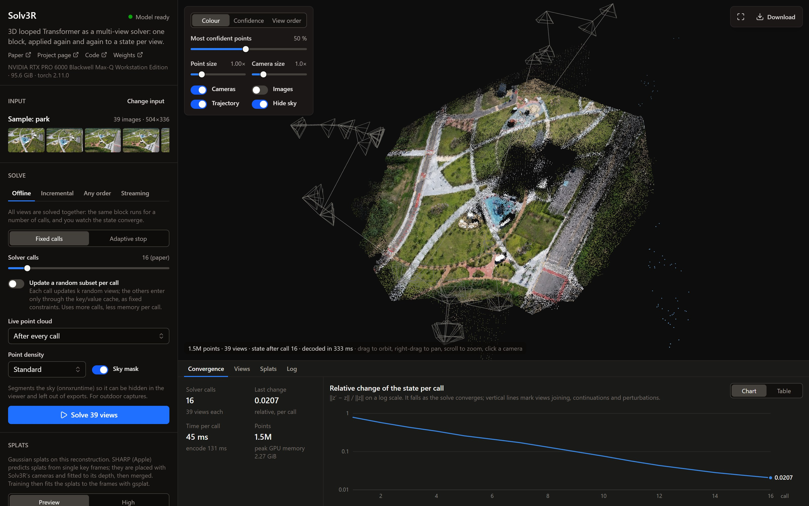
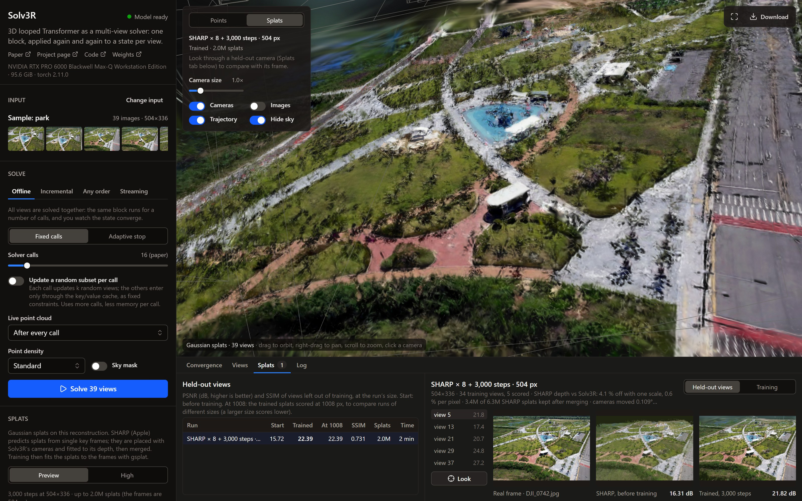
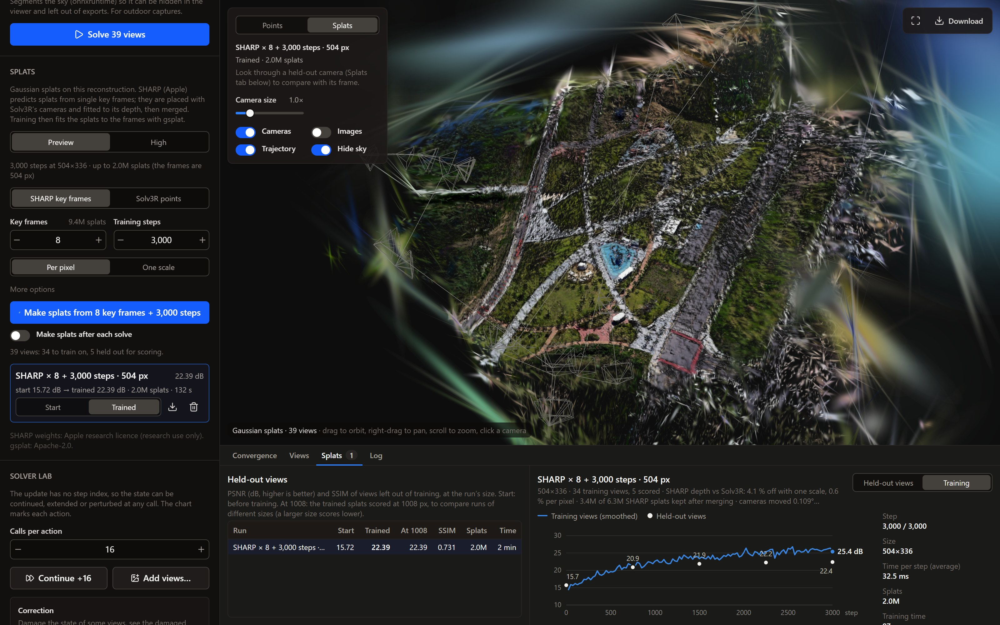

# Solv3R demo

A web app for [Solv3R: 3D Looped Transformer as a Multi-view Solver](https://ubc-vision.github.io/solv3r/)
([paper](https://arxiv.org/abs/2611.02857), [code](https://github.com/ubc-vision/solv3r),
[weights](https://huggingface.co/jgkwak/solv3r)). It runs the released model on your GPU and shows a solve as it
happens: the cameras move after every solver call, the point cloud converges, and the change of the state per call is
plotted live. A finished solve can then be turned into Gaussian splats, from [SHARP](https://github.com/apple/ml-sharp)
key frames or Solv3R's points, trained with [gsplat](https://github.com/nerfstudio-project/gsplat) at up to the full
size of the photos, and scored on views left out of training.





## What it does

- **Inputs:** the Solv3R samples (Park: 39 drone photos, Desk: 289 video frames), your photos (JPG, PNG), a
  video (the sharpest frame of each stretch, kept at up to 4K), or a live webcam.
- **Modes:** offline (fixed calls or adaptive stop), incremental, any order, streaming (L8 / L4 / S4), subset updates.
- **Solver lab:** continue a finished solve, add views to it, or damage its state and watch the solver repair it.
- **Viewer:** colour by image, confidence or time; confidence filtering; camera frustums with their images;
  trajectories; sky hiding; look through any camera. Per-view depth and confidence maps below.
- **Splats:** two presets, *Preview* (3,000 steps at up to 1008 px, about a minute and a half) and *High* (30,000 steps at the
  full size, coarse to fine, camera pose and focal length refinement, the splat count set from the size). Held-out
  PSNR / SSIM after a test-time camera alignment, runs compared side by side, rendered with
  [Spark](https://sparkjs.dev).
- **Downloads:** point cloud `.ply`, cameras and depth `.npz`, a standalone `.html` viewer, splats as 3DGS `.ply`.



## Setup

Windows, an NVIDIA GPU with a recent driver, [uv](https://docs.astral.sh/uv/), Node.js 18+ and git. The splats also
need the CUDA toolkit that matches PyTorch (12.8) and Visual Studio's C++ tools (gsplat compiles its kernels on the
first run).

```
git clone https://github.com/filliptm/solv3r-demo.git
cd solv3r-demo
.\demo\setup.ps1      # once: clones solv3r and ml-sharp, Python env with CUDA PyTorch, server deps, web client
.\demo\run.ps1        # then open http://127.0.0.1:7860
```

The Solv3R weights (470 MB) and SHARP's checkpoint (2.8 GB) download on first use. Linux and macOS: `./demo/run.sh`
after the manual setup in [demo/README.md](demo/README.md), which also documents the modes, the API, the layout of the
code and the measurements.

## License

The demo code is Apache-2.0 ([LICENSE](LICENSE)). The models it runs are not: Solv3R's weights are under the
[NVIDIA License](https://github.com/ubc-vision/solv3r/blob/main/LICENSES/NVIDIA-LICENSE.txt) (non-commercial,
research and evaluation use only) and SHARP's under the
[Apple Machine Learning Research Model License](https://github.com/apple/ml-sharp/blob/main/LICENSE_MODEL) (research
use only). Neither is included in this repository; `setup.ps1` clones their code and the weights download on first
use.
